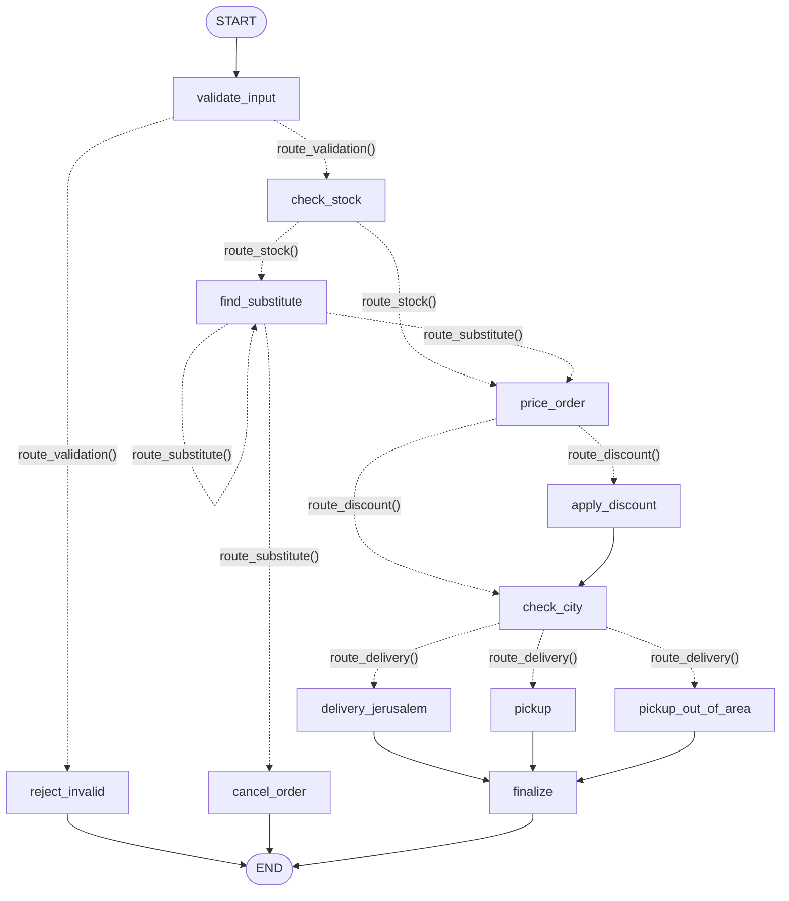

# מפרט: מערכת הזמנות למאפייה כגרף LangGraph

מאפייה קטנה בירושלים מקבלת הזמנות דרך טופס אינטרנטי. כל הזמנה כוללת מוצר, כמות, יום בשבוע ועיר.
המערכת מקבלת הזמנה, בודקת אותה, מציעה תחליף כשמוצר חסר, מחשבת הנחה ומשלוח, ומחזירה ללקוח הודעה חמה ויומן של כל הצעדים שההזמנה עברה.
בנה אותה כגרף LangGraph במחברת Google Colab.

## אילוצים טכניים
- LangGraph ב־Colab. **בלי קריאות ל־LLM ובלי API key**. כל הקוד Python דטרמיניסטי.
- ההודעות ללקוח נבנות מתבניות קבועות.
- המחברת רצה מ־session נקי של Colab, מההתחלה ועד הסוף.
- ציור הגרף עם `draw_mermaid_png()`.

## ממשק
```python
result = graph.invoke({"item": "babka", "quantity": 2, "day": "Thursday", "city": "Jerusalem"})
```
כל תוצאה, בכל מסלול, חייבת לכלול:

| מפתח | ערך |
|---|---|
| `status` | `"accepted"` / `"rejected"` |
| `item` | המוצר שנמכר בפועל, אחרי החלפה. `None` אם ההזמנה נדחתה |
| `delivery` | `"delivery"` / `"pickup"`. בדחייה: `"pickup"` |
| `total` | סכום סופי כולל משלוח. בדחייה: `0` |
| `message` | הודעה ללקוח בעברית |
| `steps` | רשימת הצעדים לפי הסדר, בפורמט `"<node>: <פירוט>"` |

## נתונים
| מוצר | מזהה | מחיר | מלאי |
|---|---|---|---|
| חלה | `challah` | 18 ₪ | 10 |
| באבקה | `babka` | 45 ₪ | 0 |
| קופסת רוגלך | `rugelach` | 30 ₪ | 3 |
| כיכר מחמצת | `sourdough` | 25 ₪ | 4 |

- `croissant` הופסק ונחשב מוצר לא מוכר.
- המלאי קבוע ולא משתנה בין הזמנות.

## חוקים
1. **קלט שגוי:** מוצר לא בתפריט, כמות שאינה מספר שלם חיובי, או יום שאינו יום בשבוע. ההזמנה נדחית עם הודעה מנומסת שלא הצלחנו להבין אותה. ההשוואה של מוצר, יום ועיר לא תלויה באותיות גדולות/קטנות ובמרווחים.
2. **העיר אינה נבדקת לתקינות ואינה גורמת לדחייה.** כל ערך מתקבל ומטופל בשלב המשלוח.
3. **תחליפים:** אם אין מספיק מלאי לכל הכמות, עוברים לתחליף הבא בשרשרת `babka → rugelach → sourdough → challah`. לחלה אין תחליף.
   - תחליף נחשב רק אם יש ממנו מלאי לכל הכמות.
   - הכמות נשארת, והמחיר הוא של המוצר החדש.
   - ההחלפה אוטומטית. ההודעה רק מיידעת את הלקוח.
   - **לכל היותר 2 הצעות.** אם אף אחת לא מתאימה, או שאין תחליף, ההזמנה מבוטלת עם הודעת התנצלות.
4. **הנחה:** 15% על סכום המוצרים, רק אם הוא **גדול מ־150** (לא כולל 150), ולא בימי שישי. ההנחה לעולם לא חלה על דמי המשלוח. עיגול ל־2 ספרות.
5. **משלוח:**
   - ירושלים (`Jerusalem` או `ירושלים`): משלוח, 20 ₪.
   - עיר ריקה, `None` או מפתח חסר: איסוף עצמי בחינם.
   - כל עיר אחרת: ההזמנה **לא** נדחית. היא עוברת לאיסוף עצמי בחינם, וההודעה מסבירה ללקוח שאין משלוחים לעיר שלו.

## מבנה הגרף

### State
`TypedDict` עם השדות:
- **קלט:** `item`, `quantity`, `day`, `city`
- **עבודה:** `requested_item` (המוצר שהלקוח ביקש במקור), `error` (סיבת הדחייה, ריק אם הקלט תקין), `attempts` (מספר ניסיונות ההחלפה), `in_stock`, `city_type`, `subtotal`, `discount`, `delivery_fee`
- **פלט:** `status`, `delivery`, `total`, `message`. `item` משמש גם כפלט, והוא המוצר שנמכר בפועל.
- `steps: Annotated[list[str], operator.add]`. כל node מחזיר `{"steps": ["<node>: <פירוט>"]}`, והרשימה מצטברת ולא נדרסת.

### Nodes
כל node הוא פונקציה שמקבלת את ה־state ומחזירה רק את השדות שהשתנו.

| Node | תפקיד |
|---|---|
| `validate_input` | נרמול ובדיקת תקינות של מוצר, כמות ויום (העיר אינה נבדקת) |
| `reject_invalid` | דחיית קלט שגוי |
| `check_stock` | האם יש מלאי לכל הכמות של המוצר המבוקש |
| `find_substitute` | מעבר לתחליף הבא בשרשרת, עדכון `item` ו־`attempts`, ובדיקת מלאי |
| `cancel_order` | ביטול עם הודעת התנצלות |
| `price_order` | חישוב `subtotal` למוצר הסופי |
| `apply_discount` | חישוב הנחה של 15% |
| `check_city` | נרמול העיר וסיווג ל־`city_type`: `"jerusalem"`, `"empty"` או `"other"` |
| `delivery_jerusalem` | משלוח, 20 ₪ |
| `pickup` | איסוף עצמי בחינם |
| `pickup_out_of_area` | איסוף עצמי בחינם, עם הסבר שאין משלוח לעיר |
| `finalize` | סכום סופי, `status="accepted"` והודעה ללקוח |

### Edges (קשתות קבועות)
- `START → validate_input`
- `reject_invalid → END`, `cancel_order → END`
- `apply_discount → check_city`
- `delivery_jerusalem → finalize`, `pickup → finalize`, `pickup_out_of_area → finalize`
- `finalize → END`

### Conditional edges (פונקציות ניתוב)
כל פונקציית ניתוב קוראת את ה־state ומחזירה את שם ה־node הבא. ערך ההחזרה מוגדר עם `Literal`, כדי שהגרף יצויר נכון.

| מאחרי | פונקציה | יעדים |
|---|---|---|
| `validate_input` | `route_validation()` | קלט שגוי ← `reject_invalid`, תקין ← `check_stock` |
| `check_stock` | `route_stock()` | במלאי ← `price_order`, חסר ← `find_substitute` |
| `find_substitute` | `route_substitute()` | נמצא ← `price_order`, לא נמצא ו־`attempts < 2` ויש תחליף נוסף ← `find_substitute`, אחרת ← `cancel_order` |
| `price_order` | `route_discount()` | `subtotal > 150` ולא שישי ← `apply_discount`, אחרת ← `check_city` |
| `check_city` | `route_delivery()` | `"jerusalem"` ← `delivery_jerusalem`, `"empty"` ← `pickup`, `"other"` ← `pickup_out_of_area` |

### שרטוט


## הודעות ללקוח
עברית, חמה ואישית, בקול של דנה בעלת המאפייה, וחתומות "באהבה, דנה". הודעה על הזמנה שהתקבלה כוללת לפי הצורך: תודה, הסבר על תחליף, הסבר על מעבר לאיסוף, משלוח או איסוף, ההנחה שהתקבלה, וסכום לתשלום. בהודעות משתמשים בשמות המוצרים בעברית.

## בדיקות במחברת
- הרצה של הדוגמה מסעיף "ממשק". התוצאה הצפויה: `rugelach`, `delivery`, `80`.
- כל ההזמנות בטבלאות הבאות, עם `assert` על הערכים הצפויים, על קיום כל 6 המפתחות, ועל רצף ה־nodes ב־`steps` (החלק שלפני `:`). בסוף, טבלת סיכום.

| # | item | qty | day | city | status | item שנמכר | delivery | total |
|---|---|---|---|---|---|---|---|---|
| 1 | pizza | 1 | Sunday | "" | rejected | None | pickup | 0 |
| 2 | challah | 0 | Sunday | "" | rejected | None | pickup | 0 |
| 3 | croissant | 2 | Monday | Jerusalem | rejected | None | pickup | 0 |
| 4 | challah | 2 | Blursday | "" | rejected | None | pickup | 0 |
| 5 | challah | 3 | Sunday | Jerusalem | accepted | challah | delivery | 74 |
| 6 | babka | 2 | Thursday | Jerusalem | accepted | rugelach | delivery | 80 |
| 7 | rugelach | 5 | Monday | Jerusalem | accepted | challah | delivery | 110 |
| 8 | babka | 4 | Monday | "" | accepted | sourdough | pickup | 100 |
| 9 | babka | 5 | Tuesday | Jerusalem | rejected | None | pickup | 0 |
| 10 | challah | 12 | Wednesday | "" | rejected | None | pickup | 0 |
| 11 | challah | 10 | Thursday | Jerusalem | accepted | challah | delivery | 173 |
| 12 | challah | 10 | Friday | Jerusalem | accepted | challah | delivery | 200 |
| 13 | sourdough | 2 | Sunday | Tel Aviv | accepted | sourdough | pickup | 50 |
| 14 | sourdough | 9 | Thursday | Jerusalem | accepted | challah | delivery | 157.7 |
| 15 | "  Babka " | 2 | thursday | jerusalem | accepted | rugelach | delivery | 80 |

רצף ה־nodes הצפוי:

| # | מה נבדק | רצף |
|---|---|---|
| 1–4 | קלט שגוי | `validate_input → reject_invalid` |
| 5 | במלאי, משלוח | `validate_input → check_stock → price_order → check_city → delivery_jerusalem → finalize` |
| 6, 15 | תחליף ראשון | `validate_input → check_stock → find_substitute → price_order → check_city → delivery_jerusalem → finalize` |
| 7 | תחליף שני, משלוח | `validate_input → check_stock → find_substitute → find_substitute → price_order → check_city → delivery_jerusalem → finalize` |
| 8 | תחליף שני, איסוף | `validate_input → check_stock → find_substitute → find_substitute → price_order → check_city → pickup → finalize` |
| 9 | ביטול אחרי 2 הצעות | `validate_input → check_stock → find_substitute → find_substitute → cancel_order` |
| 10 | ביטול, אין תחליף | `validate_input → check_stock → find_substitute → cancel_order` |
| 11 | הנחה (180 − 27 + 20) | `validate_input → check_stock → price_order → apply_discount → check_city → delivery_jerusalem → finalize` |
| 12 | שישי, בלי הנחה | `validate_input → check_stock → price_order → check_city → delivery_jerusalem → finalize` |
| 13 | מחוץ לירושלים | `validate_input → check_stock → price_order → check_city → pickup_out_of_area → finalize` |
| 14 | תחליף + הנחה + משלוח (162 − 24.3 + 20) | `validate_input → check_stock → find_substitute → price_order → apply_discount → check_city → delivery_jerusalem → finalize` |

---

## גרסאות ושינויים

**גרסה 1 (טיוטה ראשונה):** תיאור לפי שדות הטופס (מוצר, כמות, עיר), תפריט, מלאי, חלופות, הנחה ודרישה לנימה חמה.

**גרסה 2:** מפרט מלא עם קבועים בקוד, לוגיקה מפורטת לכל node ותבניות הודעה מילוליות.
- "אם הלקוח מסרב לחלופה פעמיים" הוחלף ב"אין מלאי לתחליף". אין במערכת לקוח שמשיב, יש קריאה אחת ל־`invoke`.
- קרואסון הוצא מהמלאי והוגדר כמוצר לא מוכר, כדי שלא יטופל כמוצר שנגמר.
- הוסרו פרטים לא רלוונטיים מהסיפור (שמות הבעלים, השכונה).
- נוספו הדרישות הטכניות: LangGraph, בלי LLM, `draw_mermaid_png()`, צורת `invoke` וששת מפתחות הפלט.
- נקבעו מקרי קצה שהסיפור לא סגר: אחרי חלה אין תחליף, יום לא תקין נדחה, 150 בדיוק לא מקבל הנחה, ההנחה לא חלה על משלוח.
- נוספו 15 הזמנות בדיקה עם ערכים צפויים.

**גרסה 3 (סופית):**
- קוצרו פרטי המימוש. נשארו החוקים, ההחלטות, מבנה הגרף והבדיקות.
- נוספה פסקת פתיחה עם הקשר.
- נוסף במפורש שהעיר אינה נבדקת ב־`validate_input` ואינה גורמת לדחייה.
- מבנה הגרף נכתב לפי המונחים מהשיעור: State, Nodes, Edges, Conditional edges.
- ההחלטות על משלוח ועל הנחה הפכו מ־`if` בתוך node לקשתות מותנות גלויות בגרף (`route_delivery()`, `route_discount()`), עם node ייעודי לכל תוצאה.
- `steps` מוגדר עם reducer מסוג `operator.add`, כך שהיומן מצטבר.
- לכל בדיקה נוסף רצף ה־nodes הצפוי.
